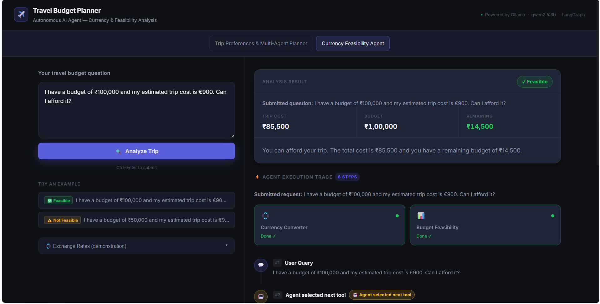
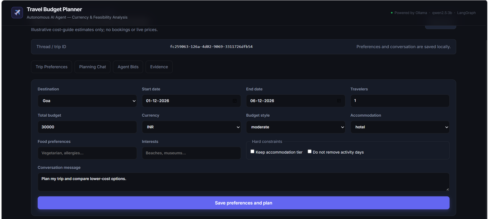
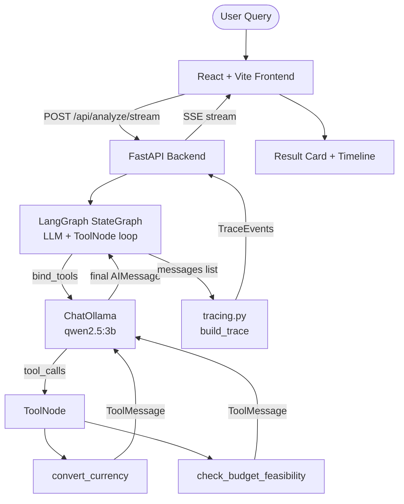
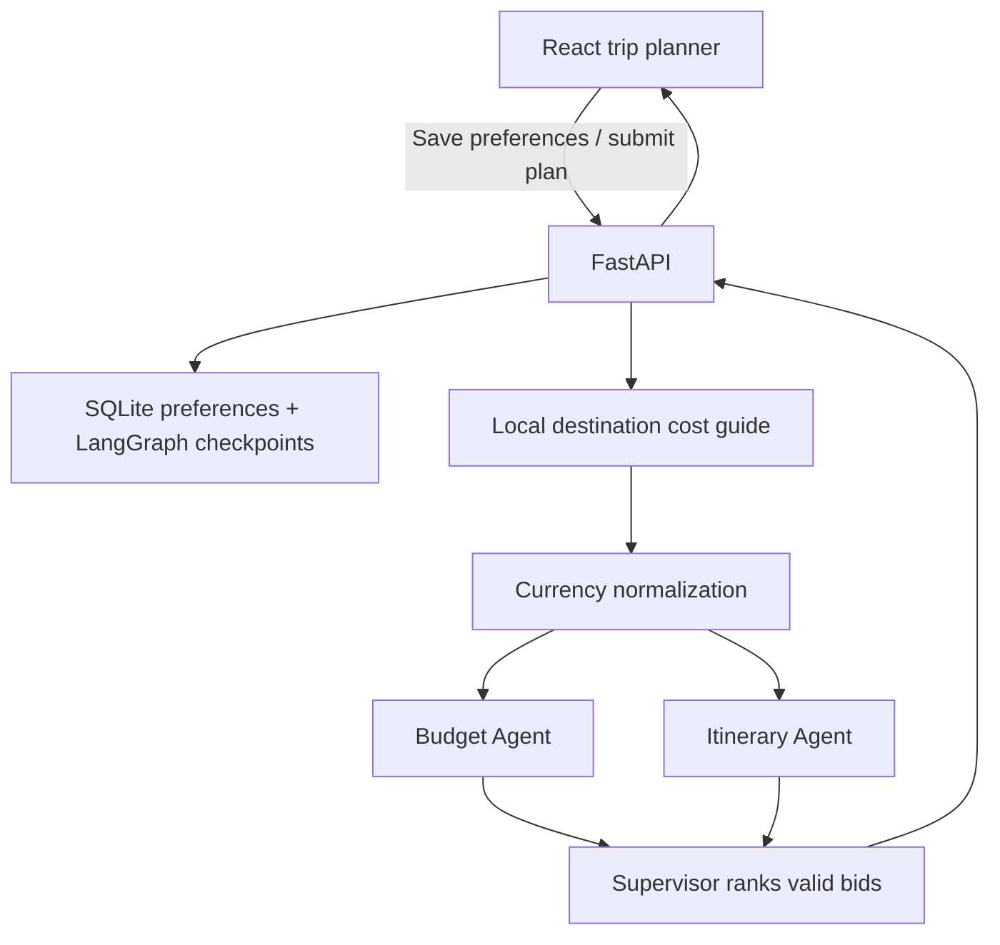

# Travel Budget Planner — Autonomous AI Agent

> A local, full-stack demo of a two-tool autonomous AI agent that answers natural-language travel-budget questions — without ever being told which tools to use or in what order.

The application also includes a persistent trip-planning workflow with destination-cost retrieval, structured specialist bids, a LangGraph supervisor, and SQLite-backed thread memory. The original currency/budget agent remains available separately.
The persistent multi-agent trip planner is the default screen; use the **Currency Feasibility Agent** tab for the original currency-conversion workflow.

---

## Screenshots






## What It Does

A user asks: *"I have a budget of ₹100,000 and my estimated trip cost is €900. Can I afford it?"*

The AI agent (powered by **Qwen 2.5 3B** running locally via **Ollama**) autonomously:
1. Recognises that currencies differ and calls `convert_currency` first.
2. Reads the result, then decides a budget comparison is needed and calls `check_budget_feasibility`.
3. Returns a clear, numeric final answer — *the model chose the tools and their order, not the code*.

The UI visibly proves this happened: a real-time execution trace shows every decision, tool call, and result.

---

## Architecture



The persistent trip-planning workflow is separate from that Ollama tool-calling path:



Budget and itinerary proposals are computed in parallel. The supervisor uses arithmetic and hard-constraint checks to select the cheapest valid bid within budget; the local guide and exchange rates are illustrative, not live.

---

## Tech Stack

| Layer | Choice |
|---|---|
| LLM runtime | Ollama (local) |
| Model | `qwen2.5:3b` |
| Agent framework | LangGraph `StateGraph` + `ToolNode`, with `langchain-ollama` `ChatOllama` |
| Backend | FastAPI + Uvicorn |
| Frontend | React 18 + Vite 5, plain CSS |
| Currency data | Hardcoded demonstration rates |
| Trip preference and thread persistence | SQLite (`backend/data/travel_planner.sqlite3`) |
| Destination guide | Local illustrative text guide (`backend/data/destination_cost_guide.txt`) |

---

## Setup & Run

### Prerequisites
- Python 3.10+
- Node.js 18+
- [Ollama](https://ollama.com) installed and running when using the agent

### 1. Pull the model
```bash
ollama pull qwen2.5:3b
ollama serve   # if not already running
```

### 2. Backend
```bash
cd travel-budget-planner

# Create virtual environment
python -m venv venv

# Activate (Windows)
venv\Scripts\activate

# Install dependencies
pip install -r backend/requirements.txt

# Start backend
uvicorn backend.main:app --reload
# → http://localhost:8000
```

### 3. Frontend
```bash
cd frontend
npm install
npm run dev
# → http://localhost:5173
```

### 4. Open the app
Navigate to **http://127.0.0.1:5173** and try an example query.

---

## Running Tests

```bash
# Backend unit tests (no Ollama required)
python -m pytest -q

# Optional real-model integration tests (Ollama + configured model required)
python -m pytest tests/test_agent.py -v -m integration
```

## Persistent trip planning

The planner UI below the original currency demo lets you save preferences, create a thread, and ask follow-ups. The REST API is:

| Method | Route | Purpose |
|---|---|---|
| `GET` | `/api/destinations` | List destinations in the local guide |
| `POST` / `PUT` | `/api/trips/{trip_id}/preferences` | Save or update trip preferences |
| `GET` | `/api/trips/{trip_id}/preferences` | Retrieve saved preferences |
| `POST` | `/api/trips/{trip_id}/plan` | Continue planning in a persisted LangGraph thread |
| `GET` | `/api/trips/{trip_id}/plan` | Restore the latest plan and bid table |
| `GET` | `/api/trips/{trip_id}/conversation` | Retrieve saved user/assistant turns |

The trip planner uses a local lexical guide lookup and deterministic cost arithmetic. Currency rates and destination costs are illustrative demo assumptions only. The cheapest feasible bid is the minimum-priced proposal within the requested budget that has no hard-constraint violations. The previous Ollama tool-calling agent remains the original two-tool demo; the TA1 comparison for the newer destination-cost scenario is explicitly a reconstructed one-pass baseline, not a claimed rerun of an unavailable matching TA1 system.

Evidence scenario, machine-readable actual run output, and regeneration instructions are in [docs/UNIT3_UNIT4_EVIDENCE.md](./docs/UNIT3_UNIT4_EVIDENCE.md) and [docs/UNIT3_UNIT4_EVIDENCE.json](./docs/UNIT3_UNIT4_EVIDENCE.json).

Configuration:

```
TRAVEL_PLANNER_DATABASE=backend/data/travel_planner.sqlite3
TRAVEL_PLANNER_DATA_DIR=backend/data
DESTINATION_GUIDE_PATH=backend/data/destination_cost_guide.txt
```

SQLite preference rows and LangGraph checkpoints are persisted in the same database. No user account or secrets are stored.

---

## What to Show in a Demo

1. **Type or use an example query** — e.g. *"Budget ₹100,000, trip cost €900, can I afford it?"*
2. **Watch the execution trace build in real time** — each step appears as the agent processes it.
3. **Point to the `🤖 Agent selected next tool` chip** — this marks the exact moment the model autonomously decided to call the second tool.
4. **Expand any step** to see raw tool arguments and results.
5. **Try the non-feasible example** to see the agent correctly report an overage.
6. **Try an unsupported currency** (e.g. JPY) to see graceful error handling without a crash.

---

## Project Structure

```
travel-budget-planner/
├── backend/
│   ├── main.py        # FastAPI app, routes
│   ├── agent.py       # LangGraph agent construction
│   ├── tools.py       # convert_currency, check_budget_feasibility
│   ├── tracing.py     # message-list → structured trace
│   ├── models.py      # Pydantic schemas
│   ├── config.py      # Ollama host, model, constants
│   ├── planning.py    # currency, budget, itinerary, supervisor bid logic
│   ├── persistence.py # SQLite trip preference and conversation store
│   ├── rag.py         # local destination cost guide retrieval
│   ├── supervisor.py  # persistent multi-agent LangGraph supervisor
│   ├── data/          # illustrative destination price guide
│   └── requirements.txt
├── frontend/
│   ├── package.json
│   └── src/
│       ├── App.jsx
│       ├── components/   (Header, ChatInput, ExampleQueries, …)
│       └── styles/index.css
├── tests/
│   ├── test_tools.py   # unit tests — no Ollama
│   └── test_agent.py   # integration tests — needs Ollama
│   ├── test_agent_unit.py
│   ├── test_trip_planner.py
│   ├── test_supervisor_memory.py
│   └── test_api.py
├── traces/
│   ├── feasible_trace.md
│   └── not_feasible_trace.md
└── docs/PROJECT_FLOW.md
```

---

## Environment Variables

The default model is `qwen2.5:3b`. Configuration can be overridden with environment variables.
Copy `.env.example` to `.env` only if you do not already have a `.env` file; preserve any existing local settings.

```
OLLAMA_HOST=http://localhost:11434
OLLAMA_MODEL=qwen2.5:3b
BACKEND_PORT=8000
MAX_ITERATIONS=6
```

To run integration tests with the documented model in PowerShell without modifying `.env`:
```powershell
$env:OLLAMA_MODEL = "qwen2.5:3b"
python -m pytest tests/test_agent.py -v -m integration
```

---

## Limitations

- **Exchange rates are hardcoded** — not live market data. Clearly labeled in the UI.
- **Qwen 2.5 3B reliability** — small models are less reliable at multi-step tool reasoning than larger ones; `temperature=0` and a tight system prompt mitigate this.
- **No authentication** — demo only; not intended for production.

---

## Jury Q&A

1. **Why hardcoded exchange rates?** — Reproducibility, no API-key dependency, predictable grading. Trade-off: rates go stale; not for real financial decisions.
2. **Where did the agent decide to call the second tool?** — See the `agent_decision` trace event (marked with the `🤖 Agent selected next tool` chip) between the two tool calls in the UI timeline.
3. **Why is this "autonomous"?** — The user never named a tool or an order. The model inferred sequencing from the system prompt's rules and the task description.
4. **Why Ollama / Qwen 2.5 3B?** — Local, private, free, runs on student hardware. Trade-off: smaller models are less reliable at multi-step tool reasoning than cloud models.
5. **Why LangGraph instead of manual orchestration?** — Calling both tools in a fixed Python sequence would just be a hardcoded pipeline. The point is that *the model* chooses when and which tool to call.
